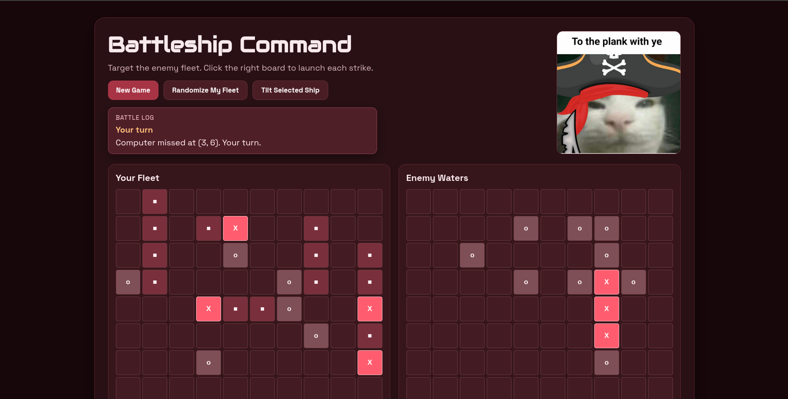

# Battleship

A simple web version of the classic Battleship game.

## JavaScript Concepts Used

- ES modules (`import` / `export`)
- Classes and objects (`Ship`, `Gameboard`, `Player`)
- Factory functions and closures (`createGameController`, `createDomManager`)
- Arrays and objects (including spread syntax)
- Destructuring assignment
- Template literals
- Default parameters
- Conditionals and loops (`if`, `for`, `while`)
- Error handling (`throw`, `try...catch`)
- Array methods (`forEach`, `map`, `every`, `some`, `includes`)
- `Set` and `Map` for game state tracking
- DOM manipulation (`createElement`, `appendChild`, `classList`, `dataset`)
- Event handling (`addEventListener`)
- Timers and async behavior (`setTimeout`, Promise `.catch()`)
